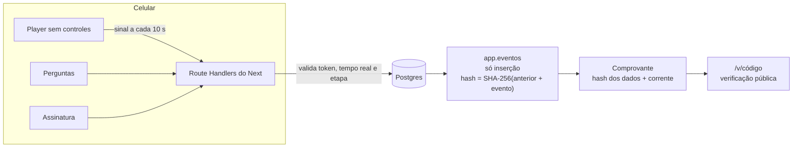

# Integra · Integração de segurança para motoristas externos

Sistema web para **documentar, de forma difícil de contestar, que cada motorista terceirizado foi instruído sobre as regras de segurança antes de entrar na área** (mineração, pedreiras, indústria).

O motorista recebe um link pelo WhatsApp (ou lê o QR Code da portaria), assiste a um vídeo que **não pode ser pulado**, responde perguntas de verificação, assina um termo de ciência com o dedo e recebe um comprovante com código e QR Code. A segurança do trabalho acompanha tudo num painel; a portaria consulta a placa e vê na hora se o motorista pode entrar.

> **Por quê:** se um motorista externo causa um acidente e a empresa não consegue provar que ele foi instruído, ela também responde. Uma planilha dizendo "assistiu" vale pouco. Aqui, cada passo fica gravado com o horário do servidor e encadeado por SHA-256, e qualquer alteração posterior é detectada.

## Demonstração

```bash
npm install
npm run dev
```

Abra http://localhost:3000. Sem configurar nada, o sistema sobe com um Postgres embutido (PGlite) e uma empresa fictícia (**Mineração Demo**) com dois meses de histórico:

- **Fazer como motorista**: percorre o fluxo inteiro no celular (vídeo demo de 48 s).
- **Ver o painel**: entrada com um clique como Administrador, Segurança ou Portaria.
- **/v**: verificação pública de comprovantes.

## O que o sistema faz

### Fluxo do motorista (celular, sem instalar nada)

1. **Boas-vindas**: confirma que o veículo está parado (um sistema de segurança não pode incentivar o uso do celular ao volante).
2. **Identificação**: nome, CPF (validado), placa (antiga e Mercosul), transportadora e aceite de privacidade (LGPD). Se o CPF já tem integração válida, mostra o comprovante em vez de refazer.
3. **Vídeo travado**: sem pausar, adiantar, acelerar, baixar ou picture-in-picture. Trocar de app ou bloquear o celular pausa o vídeo e registra a saída. Tela cheia, tela sempre ligada (Wake Lock), legenda e retomada de onde parou se a internet cair.
4. **Perguntas**: errou, a tela fica com **borda vermelha**, treme e vibra, e o motorista não sai da pergunta até acertar (com 3 s de espera entre tentativas para desestimular o chute). Alternativas embaralhadas e, opcionalmente, sorteio de N perguntas de um banco maior, para evitar a "cola" no grupo. Botão para ouvir a pergunta.
5. **Termo de ciência** com assinatura pelo dedo.
6. **Comprovante** com código (ex.: `GF5Q-9Y6B`), QR Code de verificação e PDF.

### Painel (segurança do trabalho e portaria)

| Tela | Para quê |
|---|---|
| Visão geral | Integrações do dia e do mês, motoristas liberados, vencimentos, **funil** (onde os motoristas param), **perguntas que mais erram**, transportadoras |
| Enviar link | Link único por motorista e botão que abre o WhatsApp com a mensagem pronta (`wa.me`); reenvio; situação de cada link |
| Portaria | Placa, CPF ou nome e a resposta em tela cheia: **pode entrar** (verde) ou **não** (vermelho); "conferi pessoalmente" registra o porteiro como testemunha; **cartaz com QR Code** por unidade para imprimir |
| Motoristas | Busca, filtros por situação e transportadora, histórico de cada motorista |
| Integração | **Linha do tempo** completa (link gerado, aberto, vídeo, saídas da tela, cada resposta, assinatura), estado da trilha de auditoria, comprovante e **dossiê em PDF para o jurídico** |
| Vídeo e perguntas | Editor com rascunho e publicação. **Versão publicada fica congelada** no banco; cada comprovante aponta para a versão exata vista. Detecção automática da duração. Opção de invalidar integrações anteriores quando a regra muda |
| Relatórios | Filtros por período, unidade, transportadora e situação; exporta **Excel** e **PDF** |
| Configurações | Empresa, cor, mensagem do WhatsApp, validade do link, unidades e usuários (perfis Admin, Segurança e Portaria) |

## Como a prova é garantida



- **O servidor decide que o vídeo acabou, não o celular.** Cada sinal do player só pode avançar o progresso o quanto passou de tempo real desde o sinal anterior (`src/lib/video.ts`). Adiantar o vídeo pelo navegador ou chamar a API direto não adianta: as perguntas continuam bloqueadas.
- **Trilha de auditoria encadeada.** Cada evento guarda o SHA-256 do anterior (`src/lib/hash.ts`). Mudar, apagar ou reordenar qualquer registro quebra a corrente, e a página de verificação mostra "não confere".
- **O banco recusa alterar registros de prova.** Triggers bloqueiam `UPDATE`, `DELETE` e `TRUNCATE` em eventos, respostas, assinaturas e comprovantes, e versões publicadas do conteúdo não podem ser editadas.
- **Conteúdo com hash.** O comprovante leva o SHA-256 do vídeo, perguntas e termo daquela versão.
- **Horário do servidor**, IP e aparelho em cada evento; o porteiro pode registrar que viu o motorista.

> A assinatura eletrônica simples é aceita entre particulares (MP 2.200-2/2001, art. 10, §2º) e o processo admite qualquer meio de prova legítimo (CPC, art. 369). **O texto do termo e o prazo de guarda dos dados devem ser validados pelo jurídico e pelo SESMT do cliente.**

## Stack

- **Next.js 15** (App Router, Server Actions, Route Handlers), **React 19**, **TypeScript**, **Tailwind CSS 4**
- **Postgres** do Supabase (schema próprio `app`, RLS ligado, triggers de imutabilidade) via `postgres.js`; **PGlite** embutido para desenvolvimento, demo e testes
- **hls.js** (vídeo adaptativo 360p/720p para 4G fraco), **signature_pad**, **qrcode**
- **@react-pdf/renderer** (comprovante, dossiê e relatório), **ExcelJS**
- **jose** + **bcryptjs** (sessão do painel em cookie httpOnly), **zod**
- **Vitest** (regras e fluxo completo contra um Postgres real em memória)

## Estrutura

```
src/
  app/
    i/[token]/            fluxo do motorista (link único)
    entrada/[unidade]/    entrada pelo QR Code da portaria
    v/[codigo]/           verificação pública do comprovante
    painel/               dashboard, links, portaria, motoristas, conteúdo, relatórios, configurações
    api/i/[token]/...     etapas do motorista (início, identificação, vídeo, resposta, assinatura, PDF)
    api/painel/...        comprovante/dossiê em PDF e relatório Excel/PDF
  components/motorista/   player travado, quiz, assinatura, comprovante
  lib/
    integracao/servico.ts máquina de etapas + trilha de auditoria
    video.ts, hash.ts     regras anti-fraude (testadas)
    painel/consultas.ts   consultas do painel
    pdf/documentos.tsx    comprovante, dossiê e relatório
    db/index.ts           Postgres de produção ou PGlite embutido
    db/preparar.ts        migrações e cadastro inicial ao subir o container
supabase/migrations/      schema, triggers e view de situação
scripts/                  migração, cadastro de empresa e preparo do vídeo
tests/                    regras + fluxo completo com adulteração simulada
```

## Colocando em produção (Easypanel / Docker)

O repositório tem um `Dockerfile`. Cada ambiente é um app com o próprio Postgres, na rede interna do servidor (o banco não fica exposto na internet):

| Ambiente | App | Banco | `DEMO_MODE` |
|---|---|---|---|
| Cliente | `integra-app` | `integra-db` | `false` |
| Portfólio | `integra-demo` | `integra-demo-db` | `true` |

1. **Bancos**: crie dois serviços Postgres (`integra-db` e `integra-demo-db`). Nenhum precisa de porta exposta.
2. **Apps**: crie dois serviços App a partir deste repositório (fonte Git, branch `main`, build por **Dockerfile**, porta **3000**).
3. **Variáveis** de cada app:

   | Variável | Valor |
   |---|---|
   | `DATABASE_URL` | URL de conexão **interna** do Postgres do ambiente |
   | `AUTH_SECRET` | 32+ caracteres aleatórios, um diferente por app: `node -e "console.log(require('crypto').randomBytes(32).toString('hex'))"` |
   | `DEMO_MODE` | `false` no cliente, `true` no demo |
   | `MIGRAR_AO_INICIAR` | `true`: o app cria e atualiza as tabelas ao iniciar |
   | `EMPRESA_NOME`, `UNIDADE_NOME`, `ADMIN_NOME`, `ADMIN_EMAIL`, `ADMIN_SENHA` | só no cliente: cadastro inicial, feito uma vez com o banco vazio |
   | `APP_URL` | opcional: o domínio público, se for diferente do que chega pelo proxy |

   Com o banco vazio, o demo gera a Mineração Demo sozinho.
4. **Domínio**: adicione o domínio de cada app no Easypanel, que emite o HTTPS automaticamente.
5. **Vídeo**: converta para HLS e publique a pasta gerada num endereço público (Storage do Supabase, bucket público, ou CDN):
   ```bash
   npm run video:preparar -- video-integracao.mp4
   ```
6. **No painel do cliente**: troque a senha em **Minha senha**, cole o link do `master.m3u8` em **Vídeo e perguntas**, detecte a duração, cadastre as perguntas e publique. Imprima o cartaz em **Portaria**.

Outra hospedagem (ex.: Vercel) também serve, desde que alcance o Postgres por uma conexão com SSL. Os scripts `npm run db:migrate` e `npm run db:seed` fazem o mesmo preparo a partir da sua máquina, lendo a conexão de um arquivo (`ENV_FILE=.env.producao.local`).

## Testes

```bash
npm test          # regras do vídeo, hash, quiz, validações e o fluxo completo em Postgres embutido
npm run typecheck
npm run lint
```

O teste de fluxo cobre: tentar pular o vídeo (recusado), responder antes do fim (bloqueado), sair da tela (não conta tempo), errar e ficar na pergunta, responder rápido demais após erro (429), comprovante autêntico, CPF com integração vigente e **adulteração direta no banco detectada pela verificação**.

## Próximos passos possíveis

- Envio automático do link e lembretes pela API de WhatsApp (ex.: uazapi), sem mudar a estrutura.
- Carimbo do tempo RFC 3161 no comprovante.
- Portal da transportadora para acompanhar os próprios motoristas.
- Outros públicos com o mesmo motor (visitantes, prestadores de serviço).
